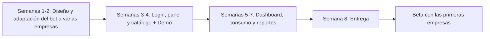

# Propuesta Económica
## Plataforma de Asesor de Ventas con IA para WhatsApp — Scroll

**Preparado por:** Santiago Guerra  
**Para:** Scroll — Agencia de Marketing  
**Fecha:** Octubre 2026  
**Vigencia de la propuesta:** 30 días

---

## 1. Qué es

Una plataforma web propia de Scroll en la que **cada cliente de la agencia tiene usuario y contraseña** para administrar su propio **asesor de ventas con IA en WhatsApp**.

El bot atiende a las personas que llegan por anuncios, videos y contenido, **filtra a las que realmente tienen intención de compra** y se las pasa a un asesor humano. Así Scroll puede mostrarle a cada cliente **cuántos leads calificados le generó su marketing**: el marketing se ve como inversión y no como gasto.

---

## 2. Opciones de plataforma

| | **A. Compra total** | **B. MVP** | **C. Licencia** |
|---|---|---|---|
| **Inversión inicial** | **$7.500.000** | **$2.500.000** | **$2.500.000** |
| **Mensualidad** | No | No | **$90.000 por empresa activa** |
| **Alcance** | Completo | Esencial | Completo |
| **Dueño del código** | Scroll | Scroll | Santiago Guerra (Scroll tiene licencia de uso y reventa) |
| **Quién opera el servidor** | Scroll | Scroll | Santiago Guerra |
| **Soporte** | Por horas, cuando se necesite | Por horas, cuando se necesite | Incluido |
| **Ideal si…** | Scroll quiere ser dueña de la tecnología | Scroll quiere validar el modelo con poca inversión | Scroll quiere vender sin preocuparse por la parte técnica |

*Valores en pesos colombianos (COP).*

### Alcance por opción

| Funcionalidad | A | B | C |
|---|:-:|:-:|:-:|
| Login, creación y recuperación de contraseña | ✅ | ✅ | ✅ |
| Panel de administrador de Scroll (crear, pausar y eliminar empresas) | ✅ | ✅ | ✅ |
| Datos de cada empresa aislados de las demás | ✅ | ✅ | ✅ |
| Editar la información del negocio y las instrucciones del bot | ✅ | ✅ | ✅ |
| Catálogo de productos y servicios (crear, editar, eliminar) | ✅ | ✅ | ✅ |
| Vincular WhatsApp con QR desde la plataforma | ✅ | ✅ | ✅ |
| Historial de conversaciones | ✅ | ✅ | ✅ |
| Medidor de consumo de IA por empresa (para que Scroll cobre) | ✅ | Básico | ✅ |
| Dashboard de resultados: atendidos, calificados, pasados a asesor | ✅ | Básico | ✅ |
| Alertas al asesor humano cuando llega un lead calificado | ✅ | — | ✅ |
| Exportar leads a Excel | ✅ | — | ✅ |
| Reportes mensuales por empresa (para mostrar el retorno al cliente) | ✅ | — | ✅ |
| Varios usuarios por empresa | ✅ | — | ✅ |
| Monitoreo y reconexión del bot si se desconecta | — | — | ✅ |
| Actualizaciones continuas de la plataforma | — | — | ✅ |

> [!NOTE]
> En la **opción B**, las funciones marcadas con "—" se pueden agregar después como una **fase 2**, que se cotiza aparte.

### ¿Por qué hay mensualidad en la opción C?

La mensualidad **no es un cobro por el software**. Paga un servicio que sigue funcionando mientras el cliente esté activo:

1. **Servidor:** cada empresa conectada mantiene una sesión de WhatsApp abierta las 24 horas, y eso consume recursos del servidor todos los meses.
2. **Mantenimiento de la conexión:** WhatsApp se actualiza seguido. Cuando eso pasa, hay que actualizar y probar el sistema para que ningún bot deje de responder.
3. **Monitoreo y reconexión:** si un bot se desconecta, se detecta y se vuelve a vincular. Mientras tanto, el cliente de Scroll podría estar perdiendo leads.
4. **Inversión inicial más baja:** a cambio, Scroll paga la plataforma completa al precio del MVP.

Además, **Scroll puede incluir este valor en lo que le cobra a sus clientes**, así que el costo pasa al cliente final y queda margen para la agencia.

En las opciones **A y B no hay mensualidad**, porque Scroll es dueña del código y opera su propio servidor.

---

## 3. Configuración por empresa (cada cliente nuevo de Scroll)

| Etapa | Horas |
|---|:-:|
| Investigación previa de la empresa | 2 |
| Jornada presencial dentro de la empresa para entender su operación y su proceso de venta | 8 |
| Configuración inicial del bot: instrucciones, documento base, catálogo y flujo de calificación | 3 |
| Preparación de la capacitación | 2 |
| Capacitación al equipo de la empresa | 4 |
| **Total** | **19 h** |

**Tarifa:** $8.338 la hora (salario mínimo 2026, jornada de 42 horas)  
**Valor por empresa:** **$158.422**, aproximado a **$160.000**

**Incluye:**
- Una semana de ajustes después del lanzamiento.

**No incluye:**
- Transporte y viáticos fuera del área metropolitana.

**Condición:** la empresa debe tener a mano el celular con el número de WhatsApp el día de la configuración.

---

## 4. Formas de pago (aplican a la plataforma)

| | Forma | Detalle |
|---|---|---|
| **1** | **De contado — Fast-Track** | Pago único al iniciar. El proyecto tiene prioridad y la entrega pasa de unas 8 a unas **6 semanas** |
| **2** | **3 cuotas** | 1/3 al iniciar · 1/3 en la demo funcional (semana 4) · 1/3 en la entrega |
| **3** | **40% / 60%** | 40% al iniciar el diseño · 60% al terminar el mes 2 (entrega del proyecto, antes de pasar a Beta) |

**Configuración por empresa:** se paga el 100% antes de la jornada presencial.

---

## 5. Cronograma estimado

---

## 6. Costos que no incluye esta propuesta

| Concepto | Quién lo paga |
|---|---|
| Consumo de IA (tokens) | Scroll, que se lo cobra a cada cliente según el medidor de consumo |
| Servidor (opciones A y B) | Scroll |
| Número y celular de WhatsApp de cada empresa | La empresa cliente |
| Dominio de la plataforma | Scroll |
| Transporte fuera del área metropolitana | Scroll o la empresa cliente |

---

## 7. Consideraciones técnicas

> [!WARNING]
> **Conexión con WhatsApp:** la plataforma usa WhatsApp Web, lo que permite arrancar rápido y sin trámites con Meta. Este método **no es la API oficial**, así que existe el riesgo de que WhatsApp restrinja o bloquee un número. Ese riesgo lo asume la empresa usuaria. Más adelante se puede migrar a la API oficial de WhatsApp Business como una fase aparte.

- **Base tecnológica:** la plataforma se construye a partir de la experiencia y la lógica de un bot que ya está funcionando en producción, lo que reduce los tiempos y el riesgo del proyecto.
- **Contrato:** las condiciones legales (propiedad intelectual, licencia, confidencialidad y soporte) se definen en el contrato.
